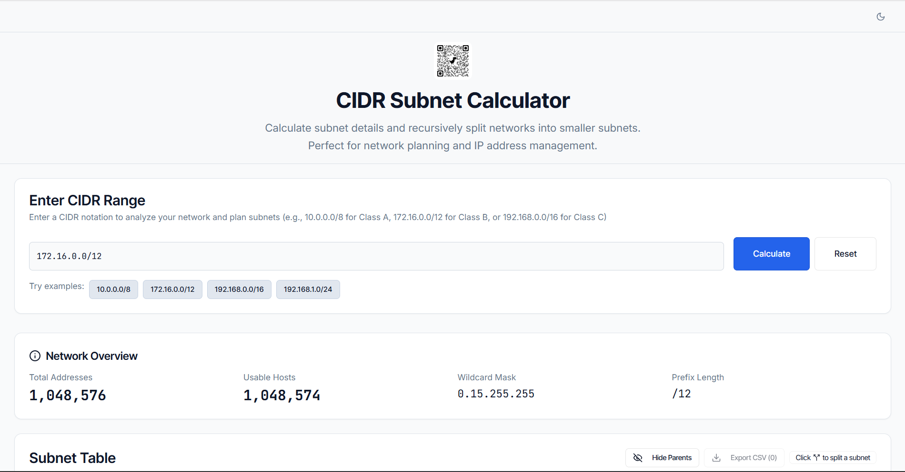

# CIDR Subnet Calculator

A subnet calculator web app and a Kubernetes network-planning API. The API generates non-overlapping VPC, node, control-plane, pod, and service CIDRs for EKS, GKE, AKS, and self-hosted clusters, as JSON or YAML, for use in Terraform and other infrastructure tools.

[](https://github.com/nicholashoule/subnet-splitter/actions/workflows/ci.yml)
[](LICENSE)
[](https://www.npmjs.com/)

[](https://github.com/nicholashoule/subnet-splitter)

## Features

### Calculator
- **Subnet details**: network and broadcast addresses, first and last usable host, total and usable host counts, subnet and wildcard masks, prefix length, and network class
- **Recursive splitting**: split any subnet in two, down to /32; each split appears under its parent with a color-coded bar for its prefix length. Remove a split to restore the parent, or turn on Hide Parents to list only the smallest subnets
- **Copy and export**: copy any row's addresses and mask, or select rows and export them to CSV
- **Runs in the browser**: nothing you enter is sent to the server; dark and light themes; works on phones

### Kubernetes network planning API
- **Separated address spaces**: nodes, control plane, pods, and services each get their own range, checked never to overlap
- **Provider-aware layouts**: EKS subnets span at least two AZs; GKE and AKS subnets are regional; one control-plane network per cluster
- **Public or private networks**: `networkMode: "private"` drops public subnets for internal load-balancer subnets
- **Multi-cluster friendly**: supply your own pod and service ranges (`podsCidr`, `servicesCidr`) and zone names (`availabilityZones`)
- **Deployment tiers** from micro to hyperscale, with compliance audits for [EKS](docs/compliance/EKS_COMPLIANCE_AUDIT.md), [GKE](docs/compliance/GKE_COMPLIANCE_AUDIT.md), and [AKS](docs/compliance/AKS_COMPLIANCE_AUDIT.md)

## Quick start

Requires Node.js 24 or 26 and npm 11.

```bash
git clone https://github.com/nicholashoule/subnet-splitter.git
cd subnet-splitter
npm ci          # exact versions from package-lock.json
npm audit       # 0 vulnerabilities before running anything
npm run dev     # web app, API, and API docs (/api/docs/ui) on http://127.0.0.1:5000
```

For production, `npm run build` writes a self-contained server bundle to `dist/index.cjs`; run it with `node dist/index.cjs` on any host with Node.js 24 or 26. [docs/development.md](docs/development.md) covers configuration (`PORT`, `HOST`, `TRUST_PROXY`), health checks, testing, CI, and contributing. On Windows, use `npm.cmd` if PowerShell blocks `npm`.

## Using the API

```bash
curl -X POST http://127.0.0.1:5000/api/k8s/plan \
  -H "Content-Type: application/json" \
  -d '{"deploymentSize":"professional","provider":"eks","vpcCidr":"10.100.0.0/18"}'
```

Add `?format=yaml` for YAML. `GET /api/k8s/tiers` returns every tier's layout (add `?provider=eks` or `&networkMode=private` for those layouts).

| Field | Notes |
|-------|-------|
| `deploymentSize` | Required: `micro`, `standard`, `professional`, `enterprise`, or `hyperscale` |
| `provider` | `eks`, `gke`, `aks`, or `kubernetes` (default; `k8s` is an alias) |
| `vpcCidr` | Private RFC 1918 space only, `/16` or smaller; a random private `/18` when omitted |
| `networkMode` | `public` (default) or `private`: internal load-balancer subnets, no public subnets |
| `podsCidr`, `servicesCidr` | Your own ranges, to keep clusters in one network apart or keep an existing service range |
| `availabilityZones` | Zone names for EKS and generic Kubernetes, assigned round-robin |
| `region`, `deploymentName` | Used for zone names, and echoed in the plan |

Pods and services are placed outside the VPC, each in an RFC 1918 block of its own (pods fall back to `100.64.0.0/10` when none has room), and never touch reserved ranges such as `172.17.0.0/16`. Public VPC ranges are rejected.

| Tier | Nodes | Public | Node | Pods | Services | Min VPC (EKS) |
|------|-------|--------|------|------|----------|---------------|
| **Micro** | 1 | /26 | /25 | /20 | /20 | /24 (/23) |
| **Standard** | 1-3 | /25 | /24 | /16 | /20 | /23 (/22) |
| **Professional** | 3-10 | /25 | /23 | /18 | /20 | /21 (/20) |
| **Enterprise** | 10-50 | /24 | /21 | /16 | /20 | /19 (/19) |
| **Hyperscale** | 50-5,000 | /23 | /20 | /11 | /18 | /18 (/18) |

The [API reference](docs/api.md) describes every field, response, and error, the [address space rules](docs/api.md#address-space-separation), [private network mode](docs/api.md#private-network-mode), [deployment tiers](docs/api.md#deployment-tiers), and Terraform examples for each provider.

## Security

- No database and no stored data; the calculator runs in the browser, and the API computes each plan from its request alone
- Production serves a strict Content Security Policy (`script-src 'self'`) and Helmet's security headers; only the Swagger UI page may load its pinned, integrity-checked assets from a CDN
- Every API request is validated with Zod and capped at 16 KB; API routes are rate limited per client; server errors never include internal details
- `npm audit` must report 0 vulnerabilities, in CI and before running any code

[SECURITY.md](SECURITY.md) says how to report a vulnerability; the [security reference](docs/security.md) lists every header, CSP directive, and rate limit.

## Documentation

- [docs/development.md](docs/development.md): setup, build, configuration, testing, CI, the website, and contributing
- [docs/api.md](docs/api.md): Kubernetes Network Planning API reference
- [docs/security.md](docs/security.md): headers, CSP, rate limits, and the dependency audit protocol
- [docs/kubernetes.md](docs/kubernetes.md): how plans are laid out, tier sizes, and the sizing formulas
- [docs/compliance/](docs/compliance/): the cross-provider comparison, and the [EKS](docs/compliance/EKS_COMPLIANCE_AUDIT.md), [GKE](docs/compliance/GKE_COMPLIANCE_AUDIT.md), and [AKS](docs/compliance/AKS_COMPLIANCE_AUDIT.md) audits
- [tests/README.md](tests/README.md): what each test file covers
- [.github/instructions/](.github/instructions/): guidelines for contributors and AI agents, indexed from [copilot-instructions.md](.github/copilot-instructions.md)
- [docs/git-conventions.md](docs/git-conventions.md): commit message conventions
- [CHANGELOG.md](CHANGELOG.md): versions; each release's notes are in its [GitHub release](https://github.com/nicholashoule/subnet-splitter/releases)

## Contributing

Contributions are welcome. See [Contributing](docs/development.md#contributing) for the workflow, checks, and code standards.

## License

MIT. See [LICENSE](LICENSE). Created by [nicholashoule](https://github.com/nicholashoule).
